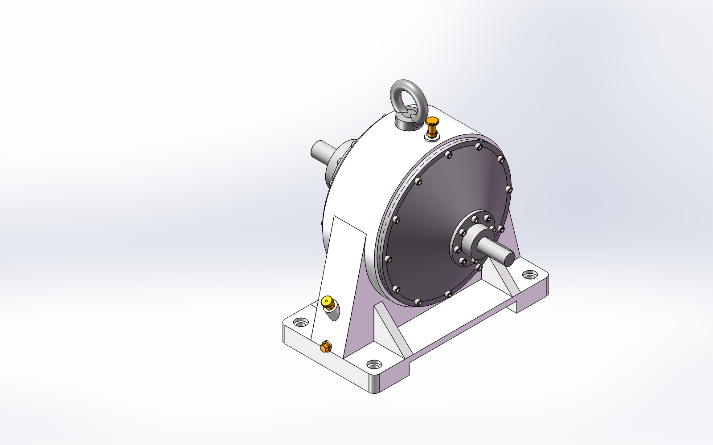

# 机械设计与机电自动化作品集

Mechanical Engineering Portfolio · 结构设计 / 传动设计 / 工程图 / 计算分析

围绕实际项目整理设计思路、关键结构和可核对的交付成果。这里优先展示“为什么这样设计、具体完成了什么”，而不是只罗列软件名称。

## 项目速览

| 非标输送与分拣 | 行星齿轮传动设计 |
| :---: | :---: |
|  |  |
| [快递包装箱分拨输送系统 →](projects/parcel-sorting/README.md) | [单级 NGW 行星减速器 →](projects/ngw-reducer/README.md) |
| 总体布局、翻转机构、分拨机构、输送驱动 | 齿数配比、MATLAB 筛选、齿宽与轴承布置 |

## 从这些案例可以看到什么

- **结构设计**：把功能要求拆解为输送、翻转、分拨和传动等子机构，组织装配关系。
- **工程图与明细表**：整理零件尺寸、左右镜像关系、标准件规格及装配标号对应关系。
- **计算辅助设计**：用 MATLAB 比较载荷、几何、齿轮参数与安装空间，说明参数选择依据。
- **软件协同**：SolidWorks 建模与装配，CAD/CAXA 图纸整理，MATLAB 参数分析与结果输出。

## 阅读方式

每个案例按“项目简介 → 关键参数 → 结构与计算 → 交付内容”组织，图片可点击放大。图片选自项目说明书和已有交付图，不使用颜色失真的文件缓存缩略图。

## 文件获取

本仓库首批公开图文案例。完整模型、图纸和计算资料可通过 [GitHub 主页](https://github.com/vincent886-zq) 联系交流；超过 100 MB 的单文件采用预览展示，不直接放入普通 Git 文件。

涉及外购标准件、既有基础模型的案例，在项目页说明本阶段工作范围。

---

[GitHub 主页](https://github.com/vincent886-zq) · [小米散热背夹第三方控制软件](https://github.com/vincent886-zq/Cooling-Fan-R01P-M-Third-party-control-software)
