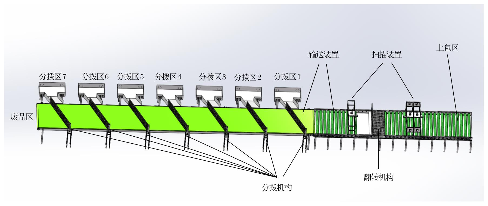
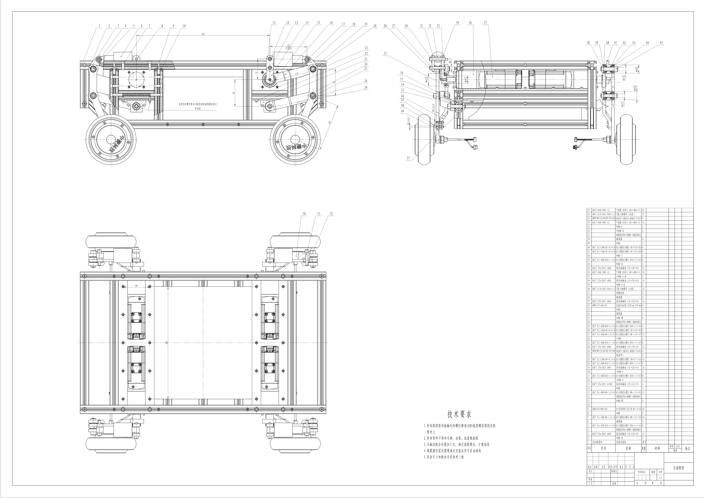
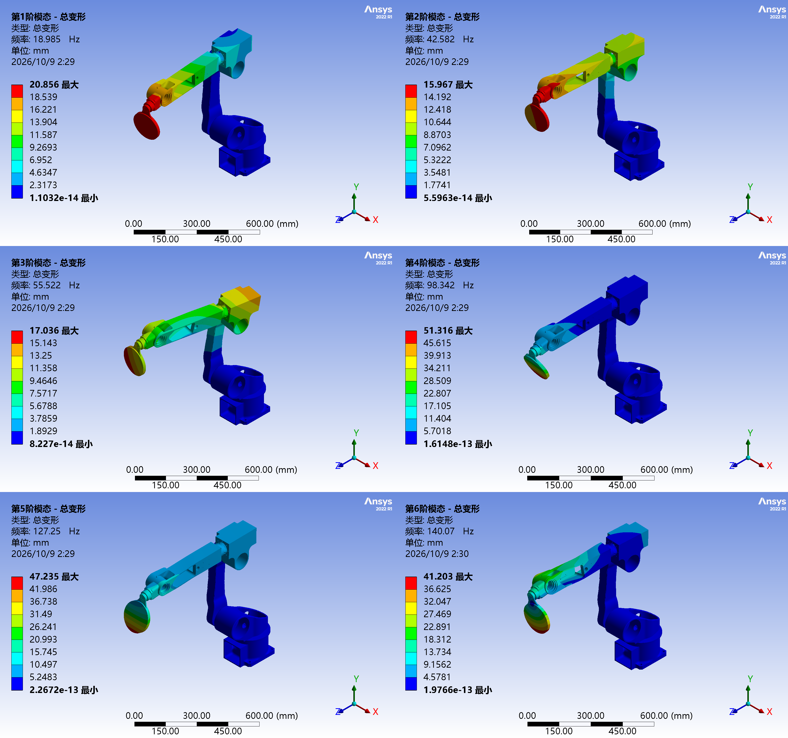
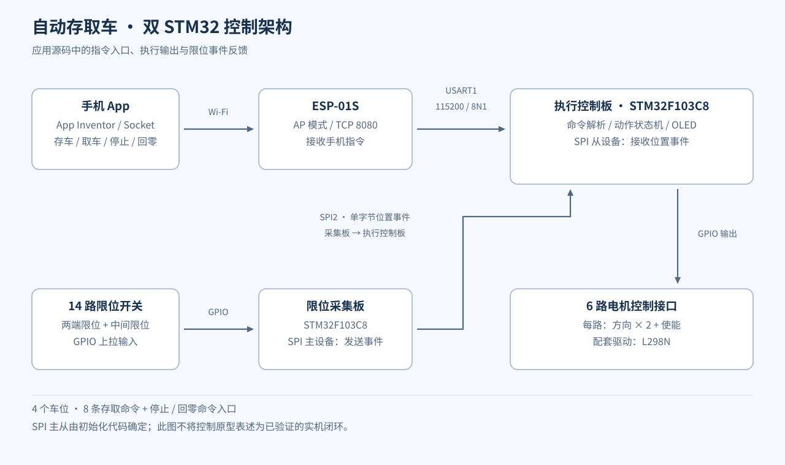
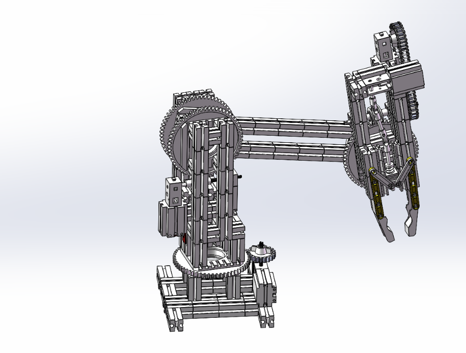

# 机械设计与机电自动化作品集

Mechanical Engineering Portfolio · 接单工程案例 / 结构设计 / 工程图 / 有限元分析 / 机电控制

以图纸、模型、分析结果和程序源码展示具体工作。点击下方图片进入案例，查看简介、资料和实现细节。

## 项目目录

### 1. Hyper 机械腿结构与工程图

[机械腿：连杆、脚踝 / 脚掌结构，原生工程图预览与模型下载 →](projects/hyper-leg/README.md)

### 其他机械工程案例

| 快递包装箱分拨输送系统 | 轮腿机器人底盘工程图 | 击球机器人有限元分析 |
| :---: | :---: | :---: |
|  |  |  |
| [查看图文介绍与模型下载 →](projects/parcel-sorting/README.md) | [查看图纸与 DWG 下载 →](projects/wheel-leg/README.md) | [查看工况与仿真结果 →](projects/robot-fea/README.md) |
| SW 零件与装配、DWG、PDF | 最终总装图与零件图 | 模态、接触瞬态、脉冲响应 |

### 自动存取车控制原型

[自动存取车：STM32、Wi-Fi 指令与限位采集 →](projects/automatic-parking-control/README.md)

以嵌入式代码为主：双 STM32F103C8、6 路电机控制接口、14 路限位输入、4 个车位的存取命令；附源码与 SVG 程序逻辑图。

### 慧鱼教学机器人

[慧鱼三自由度机械臂与手机上位机 →](projects/fischertechnik-arm/README.md)

模块化机械结构、D-H 运动学与 SolidWorks 几何核对，结合 STM32、ESP-01S 和 App Inventor 手机界面设计。

## 三组作品，独立维护

- **接单工程作品**：本仓库，展示机械结构、工程图、仿真与机电项目。
- **[科研仪器采集与控制软件](https://github.com/vincent886-zq/Research-Instrumentation-Control)**：电流 / 位移采集、电主轴 HMI、有线 / Wi-Fi 手轮。
- **[散热背夹第三方控制软件](https://github.com/vincent886-zq/Cooling-Fan-R01P-M-Third-party-control-software)**：独立软件项目。

## 资料获取

快递分拨案例提供 SolidWorks 原生模型及二维 DWG、PDF 图纸；轮腿案例提供最终 DWG。模型请保留解压后的目录关系，避免丢失装配引用。

超过 100 MiB 的单个文件不放入普通 Git 文件；其余资料可通过 [GitHub 主页](https://github.com/vincent886-zq) 联系交流。

---

[GitHub 主页](https://github.com/vincent886-zq) · [小米散热背夹第三方控制软件](https://github.com/vincent886-zq/Cooling-Fan-R01P-M-Third-party-control-software)
