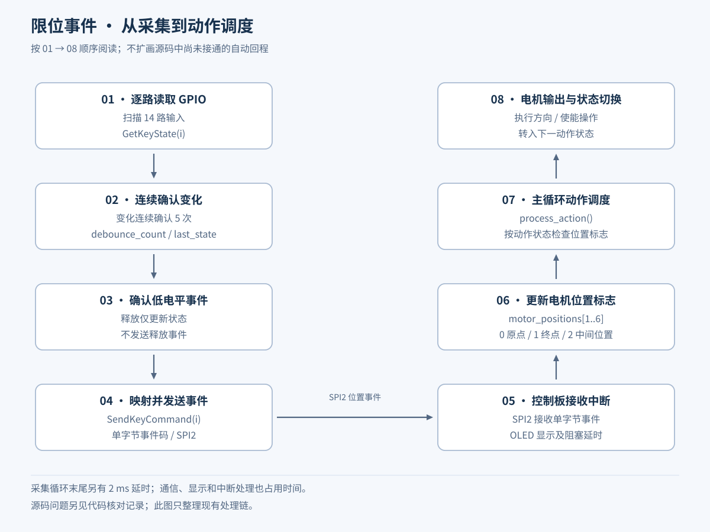

# 自动存取车控制原型

STM32F103C8 · Embedded C · Keil µVision 5 · ESP-01S · SPI · App Inventor

面向两行两列车位的存取车控制程序。采用两块 STM32 分担执行控制与限位采集：控制板解析手机命令、驱动横移/升降及存取电机；采集板扫描限位开关，通过 SPI 发送位置事件。本案例重点展示程序架构、通信协议、I/O 分配和动作调度，不混用其他车库的三维模型。

## 控制架构

应用层的“控制板/采集板”与 SPI 主从角色不同：采集板主动发送限位事件，是 SPI 主设备；控制板通过 SPI 接收中断处理事件，是 SPI 从设备。

## 代码中的规模与模块

| 项目 | 源码内容 |
| --- | --- |
| 主控平台 | 两块 STM32F103C8；原工程采用 STM32 标准外设库 |
| 执行接口 | 6 路电机，每路包含两根方向线和一根使能线；配套接线资料使用 3 个 L298N 模块 |
| 限位采集 | 14 路上拉输入，包含 6 组两端限位和横移/升降中间限位 |
| 车位命令 | 4 个车位 × 存车/取车，共 8 条业务命令，另有停止、回零，共 10 条命令 |
| 手机通信 | App Inventor Socket 扩展；ESP AT 指令配置 AP 与 TCP 服务；USART1 为 115200、8N1，TCP 端口 8080 |
| 板间通信 | SPI2，8 位、MSB 优先、CPOL=0、第一边沿采样；单字节事件码 |
| 本地显示 | OLED 显示网络初始化状态、接收指令及限位事件 |
| 动作组织 | 定义 8 个动作状态，划分横移、升降、伸出、等待及返回阶段 |

以上数量来自代码结构，不是实测精度、吞吐量或可靠性指标。

## 手机命令与动作组织

| 指令 | 意义 |
| --- | --- |
| `c11` / `q11` | 车位 (1,1) 存车 / 取车 |
| `c12` / `q12` | 车位 (1,2) 存车 / 取车 |
| `c21` / `q21` | 车位 (2,1) 存车 / 取车 |
| `c22` / `q22` | 车位 (2,2) 存车 / 取车 |
| `stop` | 停止命令入口 |
| `zero` | 回零命令入口 |

控制板通过 `USART1_IRQHandler()` 接收 ESP 的 `+IPD` 数据，在主循环识别上述短命令，随后调用 `execute_parking()` 或 `execute_retrieving()`。`process_action()` 根据限位状态调度电机。存车与取车在伸出后的竖直动作方向上区分：存车下降、取车上升。

位置表保存横向 110/350、竖向 80/270、伸出 180 的名义位置值。实际程序以开关事件判断位置，没有编码器位置环，不能将这些数值描述为已实现的毫米级定位精度。

## 限位采集程序

采集板每轮读取 14 路输入，连续 5 次检测到状态变化后更新状态；仅在确认低电平触发时发送事件。循环末尾包含 2 ms 延时；SPI 发送和 OLED 显示也占用时间，因此不把消抖时间固定表述为 10 ms。

| 执行对象 | 原点事件 | 终点事件 | 中间位置事件 |
| --- | --- | --- | --- |
| M1 | `0x01` | `0x02` | — |
| M2 | `0x03` | `0x04` | — |
| M3 | `0x05` | `0x06` | — |
| M4 | `0x07` | `0x08` | — |
| M5 横移 | `0x09` | `0x10` | `0x13` |
| M6 升降 | `0x11` | `0x12` | `0x14` |

事件码按程序原值列出，`0x09` 的下一项是 `0x10`，不是 `0x0A`。

## 电机 I/O 分配

| 电机 | 使能 | 方向 1 | 方向 2 |
| --- | --- | --- | --- |
| M1 | PA0 | PA1 | PA2 |
| M2 | PA3 | PA4 | PA5 |
| M3 | PA6 | PA7 | PA8 |
| M4 | PA11 | PA12 | PB0 |
| M5 | PB3 | PB4 | PB5 |
| M6 | PB1 | PB6 | PB7 |

SPI2 使用 PB12–PB15，USART1 使用 PA9/PA10。采集板的 14 路输入使用 PA0–PA10、PB0、PB10、PB11。

## 源码与实现范围

- [控制板 main.c](src/controller/main.c)：命令解析、电机接口、位置事件及动作状态机。
- [限位采集板 main.c](src/limit-node/main.c)：GPIO 扫描、软件消抖、SPI 事件上报。
- [代码核对记录](CODE_REVIEW.md)：当前快照的状态机、定时及停止处理问题。

公开内容为两个应用层入口源码，不包含完整 Keil 工程、标准外设库、启动文件及 OLED/延时驱动；网络配置字符串替换为示例占位符，其余保留原逻辑。原型代码中仍有待接通的回程分支，不能作为已验证的全自动循环固件直接部署。

## 项目能力点

双控制器任务拆分、UART/ESP 指令接收、SPI 自定义事件协议、GPIO 电机驱动、限位开关消抖、动作状态机及手机交互接口设计。
