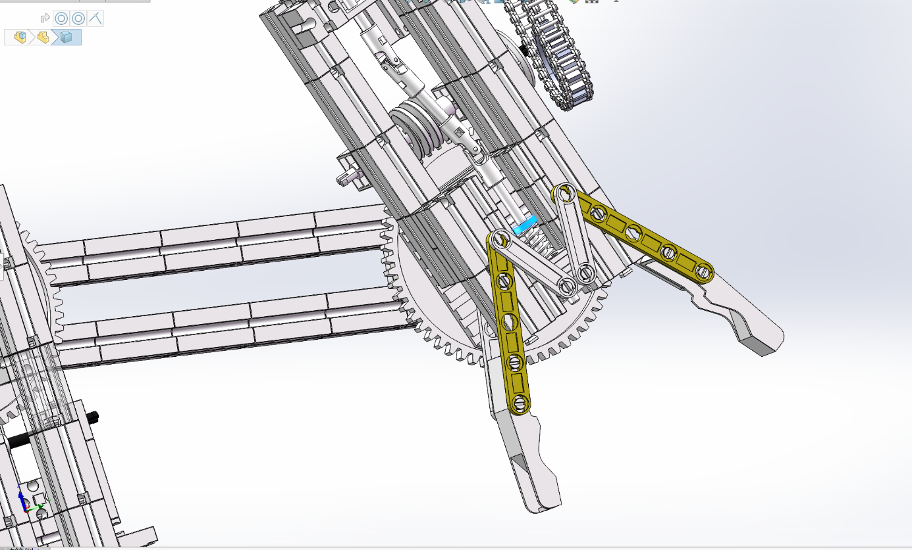
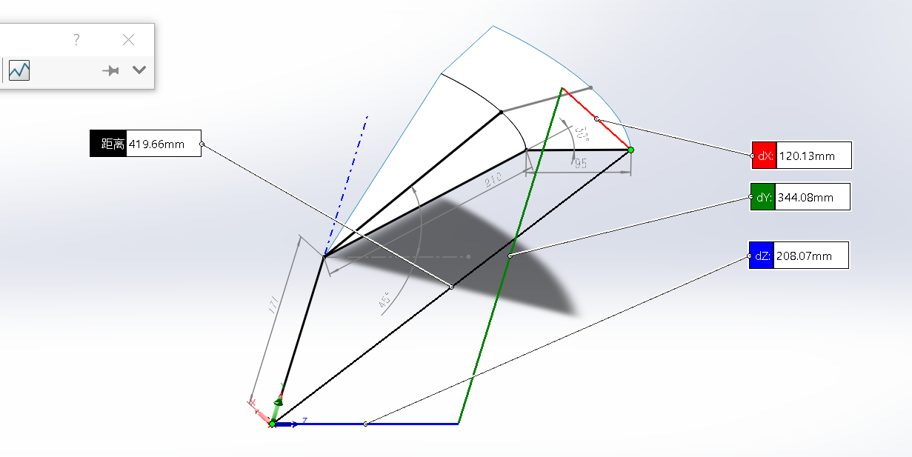
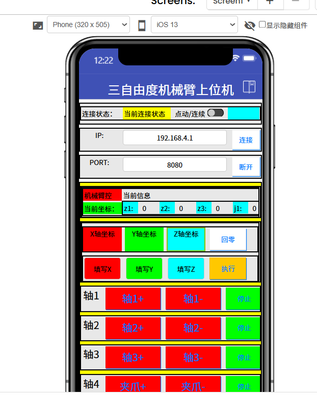
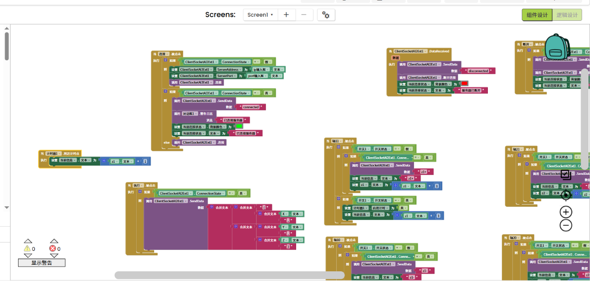

# 慧鱼三自由度机械臂与手机上位机

`慧鱼 / Fischertechnik` `SolidWorks` `运动学` `STM32` `App Inventor`

## 项目简介

基于慧鱼标准组件搭建三自由度关节式机械臂，结合 SolidWorks 装配、运动学分析和手机上位机设计，组织从目标坐标输入到关节指令的控制方案。工作重点包括机构装配、D-H 参数与正逆运动学、微控制器通信及可视化操作界面。

图 1｜说明书中的机械臂装配模型，包含基座、连杆、关节传动与末端夹爪。

## 机械结构与运动学

采用 RRR 三自由度串联构型，夹爪开合独立控制。机构利用慧鱼构件完成模块化连接，关节传动及末端执行结构见下图。

图 2｜末端夹爪及传动结构局部。

建立关节坐标系和改进 D-H 参数关系，整理正、逆运动学计算，并将连杆长度、角度和末端位置映射到 SolidWorks 草图进行几何核对。详细几何方案的基座高度为 171 mm，两段连杆长度为 210 mm 和 95 mm。

图 3｜说明书中的几何核对示例；图内坐标方向以该 SolidWorks 草图坐标系为准。

## 微控制器与通信方案

控制方案采用 STM32F103C8T6、L298N 电机驱动及 ESP-01S Wi-Fi 通信。手机端下发操作指令，微控制器解析目标坐标或关节控制命令，结合运动学关系生成关节目标。

工作内容包括目标指令解析、当前坐标与关节状态记录，以及点动、连续动作和回零的控制逻辑组织。

## 手机上位机

使用 App Inventor 设计手机操作界面，包含连接状态、IP/端口设置、点动与连续模式切换、坐标输入、执行、回零和各轴正反向操作。

图 4｜连接、坐标输入和三轴操作区域的界面截图。

图 5｜App Inventor 的连接处理、坐标指令发送和轴操作逻辑片段。

## 项目成果

- 慧鱼机械臂三维装配与关节、夹爪结构表达。
- D-H 参数、正逆运动学推导及几何验证资料。
- STM32 与 ESP-01S 通信、电机驱动及指令处理方案。
- App Inventor 手机界面与部分积木逻辑设计。

本页图片选自项目说明书，展示范围为机械结构、运动学和上位机设计资料。

[← 返回作品集](../../README.md)
