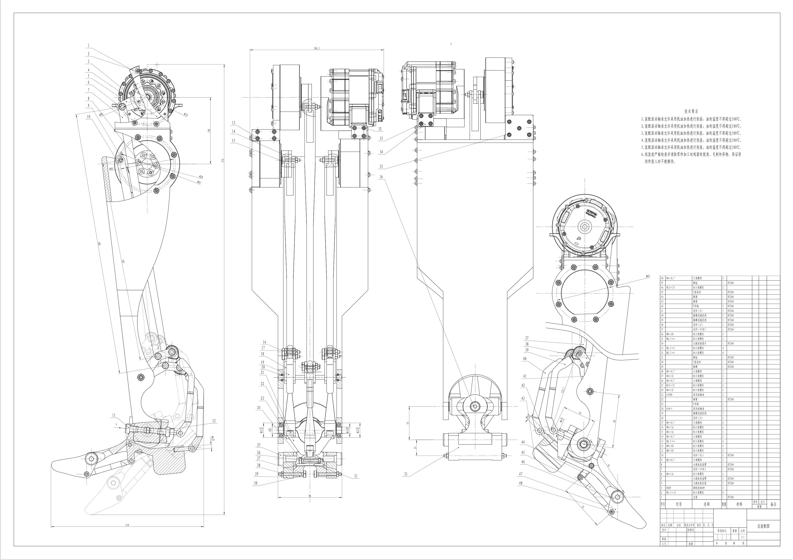
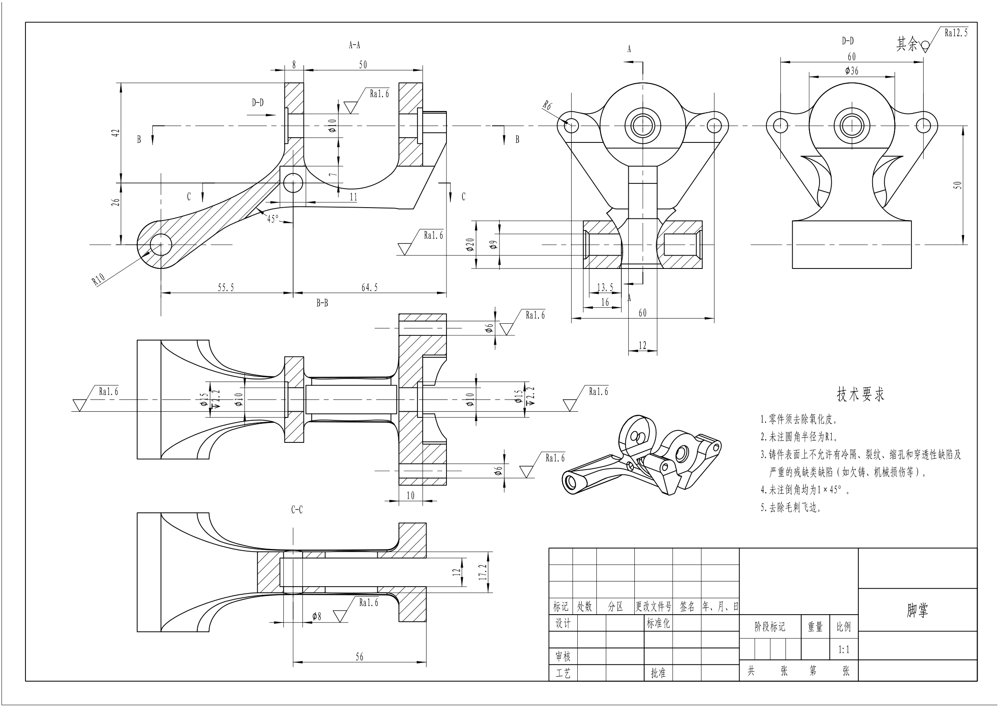
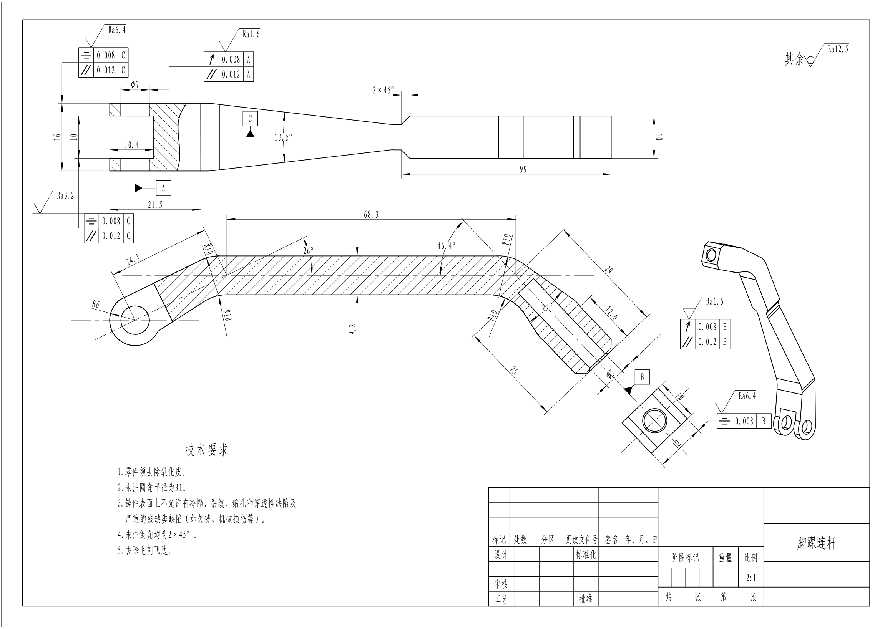

# Hyper 机械腿结构与工程图

`SolidWorks` `CAD / CAXA` `机械腿` `连杆机构` `装配与零件图`

围绕机械腿整理电机安装、腿部支架、传动连杆及脚踝 / 脚掌结构，提供三维装配与二维图纸。与轮腿机器人底盘分开展示，本页重点是机械结构及图纸表达。

图 1｜机械腿总装配图，包含多视图、局部剖视和零件明细。原图标注总高 676 mm，明细列出 3 个 DM8009 电机。[查看高清 PDF](pdf/assembly.pdf)

图 2｜脚掌零件图：多处剖视、安装孔与尺寸、表面粗糙度及技术要求。[查看 PDF](pdf/foot.pdf)

图 3｜脚踝连杆零件图：结构尺寸、角度、形位公差与基准表达。[查看 PDF](pdf/ankle-link.pdf)

## 资料下载

模型包请全部下载并解压至同一目录，保留文件名，随后打开 `hyper_leg.SLDASM`。随包包含脚踝子装配、简化模型及电机 / 轴承 / 紧固件等装配配套模型；采购件模型用于表达安装关系。

- [SolidWorks / STEP 模型，第 1 包](downloads/hyper_leg_models_01.zip)
- [SolidWorks / STEP 模型，第 2 包](downloads/hyper_leg_models_02.zip)
- [SolidWorks / STEP 模型，第 3 包](downloads/hyper_leg_models_03.zip)
- [SolidWorks / STEP 模型，第 4 包](downloads/hyper_leg_models_04.zip)
- [SolidWorks / STEP 模型，第 5 包](downloads/hyper_leg_models_05.zip)
- [SolidWorks / STEP 模型，第 6 包](downloads/hyper_leg_models_06.zip)
- [DWG 工程图包：10 张零件图 + 1 张总装图](downloads/hyper_leg_DWG.zip)
- [PDF 工程图包：全部 11 张](downloads/hyper_leg_PDF.zip)

图纸包含总装配图、支架、小腿电机摇臂、脚掌及其变型、脚趾、脚踝连杆、Y 型连杆和三种连杆。图纸包与预览均来自同一批整理后的 DWG；预览由 AutoCAD 原生打印 PDF 后转为 PNG，不重绘几何或标注。

本案例展示机械结构、三维装配与工程图，不包含步态控制、承载试验或整机行走验证。

[← 返回接单作品集](../../README.md) · [轮腿机器人底盘](../wheel-leg/README.md)
