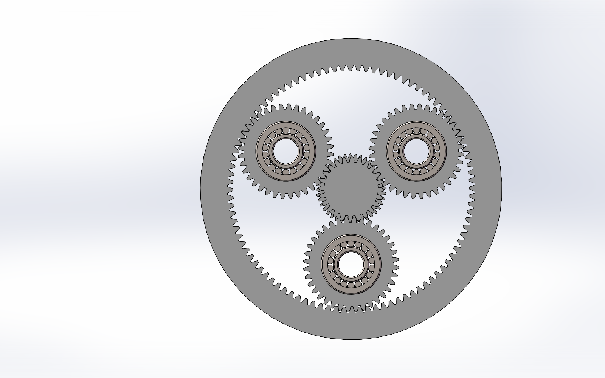
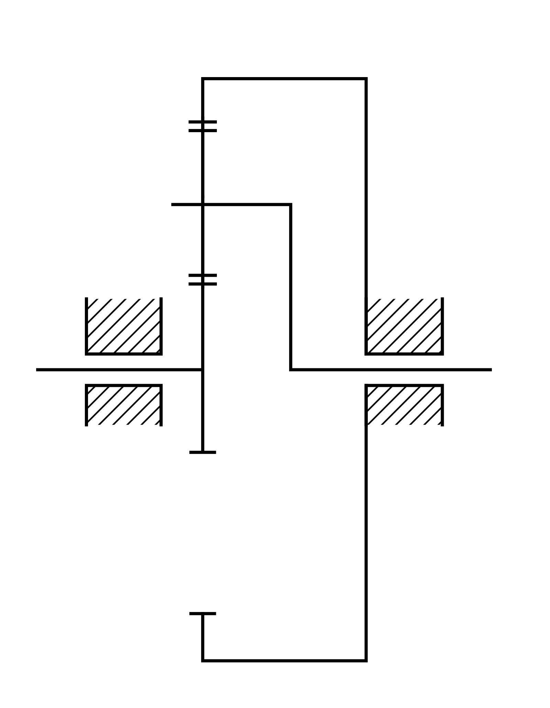

# 单级 NGW 行星齿轮减速器

`传动设计` `MATLAB` `SolidWorks` `齿轮与轴承` `计算说明书`

## 项目简介

按太阳轮输入、内齿圈固定、行星架输出的单级 NGW 方案，开展齿数配比、几何条件、强度约束与装配空间的参数筛选，并建立齿轮、轴系、行星架、箱体及附件的三维装配资料。


图 1｜已有三维装配版本，展示箱体、端盖、底座、吊环及润滑附件。

## 输入条件与齿轮参数

| 项目 | 数值 |
| --- | --- |
| 输入功率 | 11.5 kW |
| 输入转速 | 1200 r/min |
| 传动比 | 5 |
| 输出转速 | 240 r/min |
| 行星轮数量 | 3 |
| 太阳轮 / 行星轮 / 内齿圈齿数 | 24 / 36 / 96 |
| 模数 / 压力角 | 3 mm / 20° |
| 选用齿宽 | 42 mm |
| 中心距 | 90 mm |

## 从约束到齿数组合

对于内齿圈固定的单级 NGW：

```text
i = 1 + zr / zs = 1 + 96 / 24 = 5
zr = zs + 2zp = 24 + 2×36 = 96
a = m(zs + zp)/2 = 3×(24 + 36)/2 = 90 mm
(zs + zr)/3 = (24 + 96)/3 = 40
```

传动比、同心条件和三行星等间隔装配条件共同限定齿数组合，而不是先固定齿数再补写依据。MATLAB 资料保留了 6902 组候选记录，其中 4987 组通过程序设定的组合筛选。



图 2｜三行星齿轮组的已有建模视图。

## 为什么齿宽选 42 mm

本方案的计算记录给出约 27.2 mm 的最低强度齿宽，向上取整为 30 mm 可作为强度方案；但最终结构还需容纳行星轮内的双轴承布置。

两只轴承各宽 19 mm，加 4 mm 的布置间隔，轴向安装尺寸为：

```text
19 + 19 + 4 = 42 mm
```

因此选用 42 mm 是将齿轮强度与轴承安装空间统一后的结构选择，不是仅按强度最小值直接建模。

## 轴系与附件

- 输入轴采用深沟球轴承支承，方案中选用 6308。
- 行星轮采用圆柱滚子轴承，方案中选用 NU306E，每个行星轮两只，共六只。
- 输出和行星架支承按后续阶梯轴结构采用 6022、6222 等深沟球轴承配置。
- 外壳、端盖及润滑附件在装配阶段结合轴承安装位置和连接面布置完善。



图 3｜说明书中的传动简图，用于说明固定构件与输入、输出关系。

## 交付成果

计算说明书、MATLAB 参数筛选程序与候选表、齿轮及轴系三维模型、装配资料和标号明细表。图 1、图 2 为已有建模阶段视图，后续轴系与附件按图纸版本继续细化。

[← 返回作品集](../../README.md)
