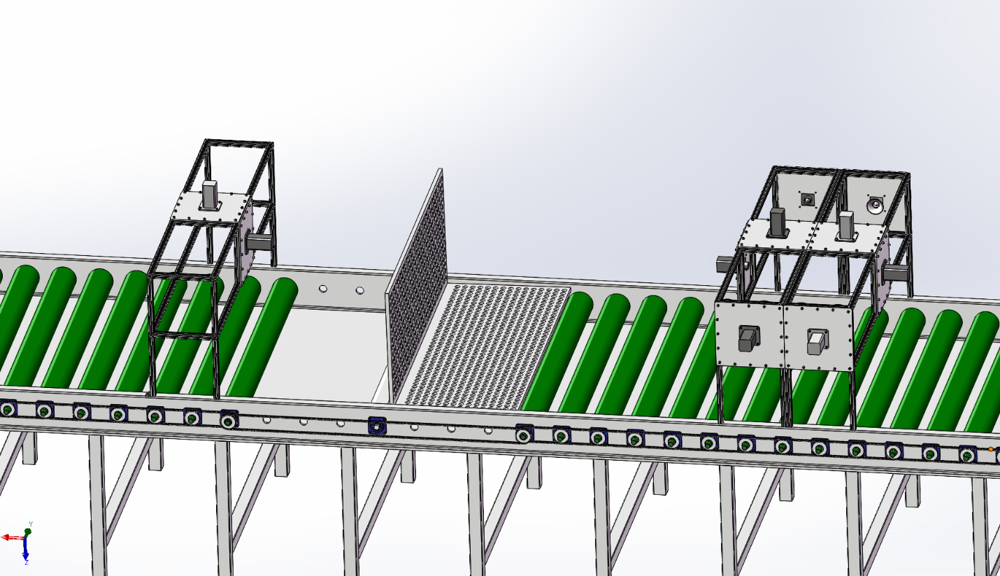
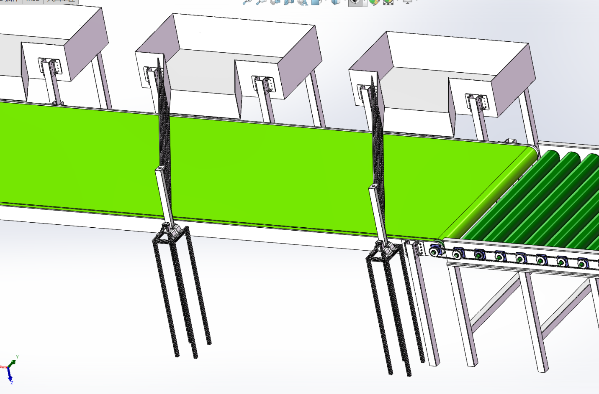
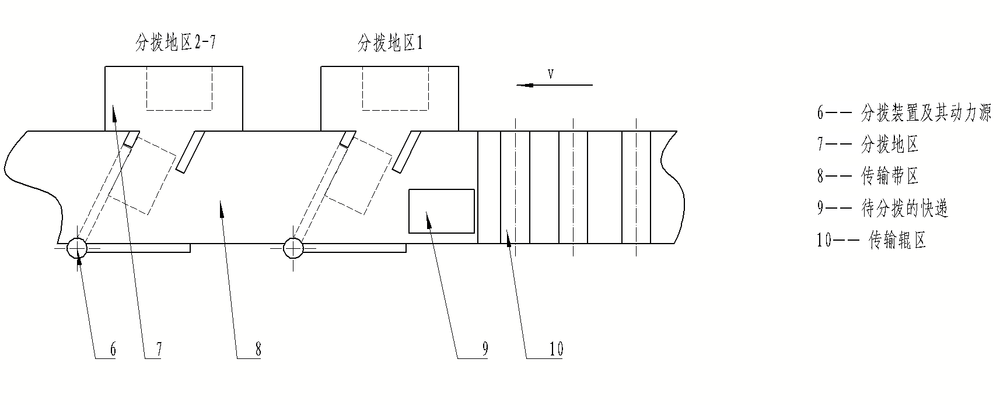
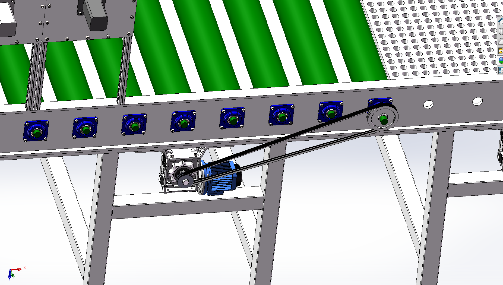

# 快递包装箱分拨输送系统

`非标设备` `SolidWorks` `输送传动` `机构设计` `工程图`

## 项目简介

面向包装箱连续输送与多格口分拨，完成输送线总体方案、翻转单元、分拨执行机构及驱动传动的设计整理。工作重点是把上料、检测、姿态调整和分拨组织为可表达、可出图的机械系统。

图 1｜说明书中的总体布局：沿主输送线配置上料、检测、翻转和分拨单元。

## 方案参数

| 项目 | 设计值 |
| --- | --- |
| 分拨格口 | 7 个 |
| 姿态调整 | 90° 翻转 |
| 输送设计速度 | 1.2 m/s |
| 辊筒直径 | 100 mm |
| 输送驱动功率方案 | 0.75 kW |

## 关键结构

### 1. 翻转与输送衔接

翻转机构布置在主输送路径中，通过导向与姿态调整为后续分拨提供统一的来料状态。设计时需要同时考虑箱体通过空间、前后辊筒衔接和执行机构安装位置。

图 2｜翻转区域的三维结构，表现执行机构、导向板与辊筒输送段的相对关系。

### 2. 多格口分拨

沿线重复布置分拨模块，模块由分拨板、驱动与支撑部分组成。将重复单元模块化，有利于保持接口和安装关系一致，并便于在总装图中逐级表达。

图 3｜分拨模块局部，重点展示分拨板、驱动安装和机架连接。

图 4｜分拨单元运动关系示意，用于对应说明书中的机构分析。

### 3. 输送驱动

对输送驱动及带、齿轮或链式传动方案进行计算与选型整理，结合辊轴、轴承座及机架安装位置完成结构表达。

图 5｜输送段传动与电机安装局部。

## 本阶段工作与成果

- 编制输送、姿态翻转和多格口分拨的总体方案。
- 整理驱动功率、传动方案和执行机构计算。
- 形成装配图及辊轴、带轮、链轮、轴承座等零件工程图。
- 将总体布局、机构简图和三维局部图组织进设计说明书。

本案例展示机械方案与图纸成果；速度和格口数量为设计参数。

[← 返回作品集](../../README.md)
