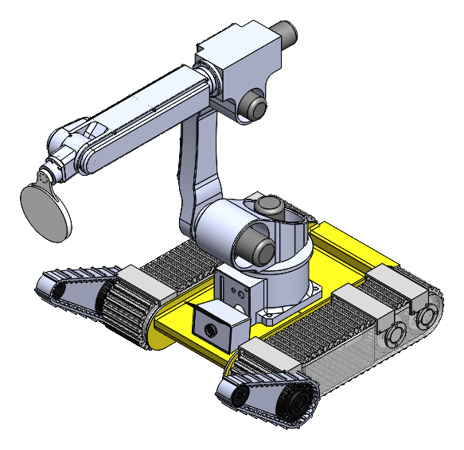
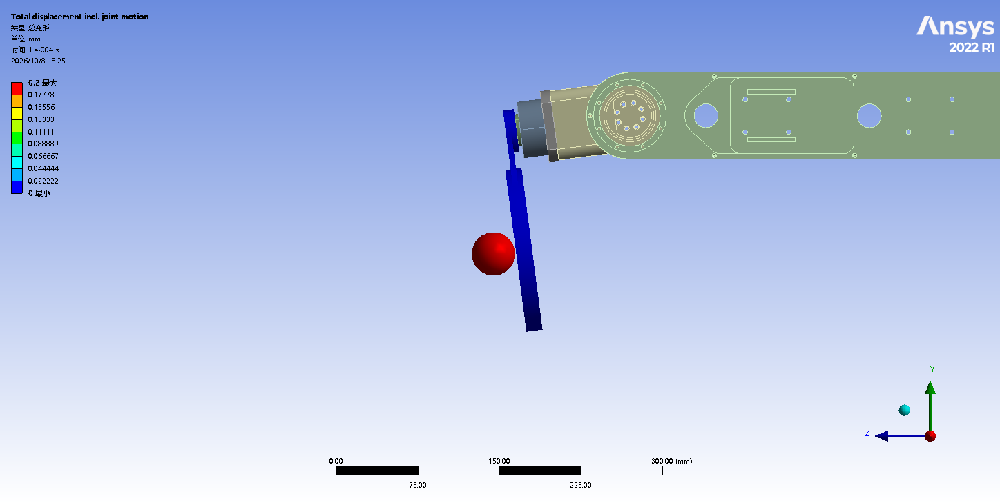
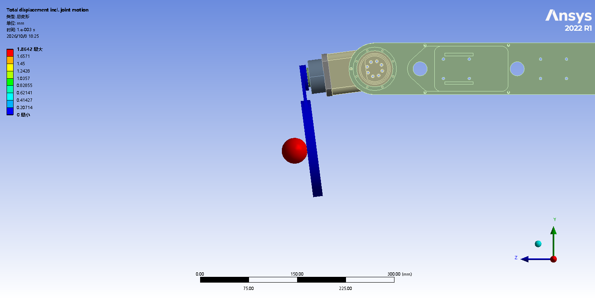
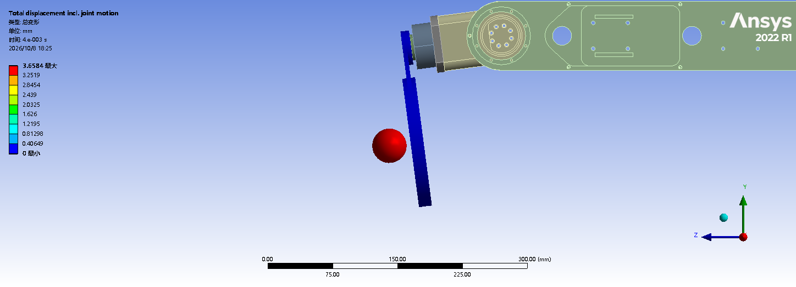
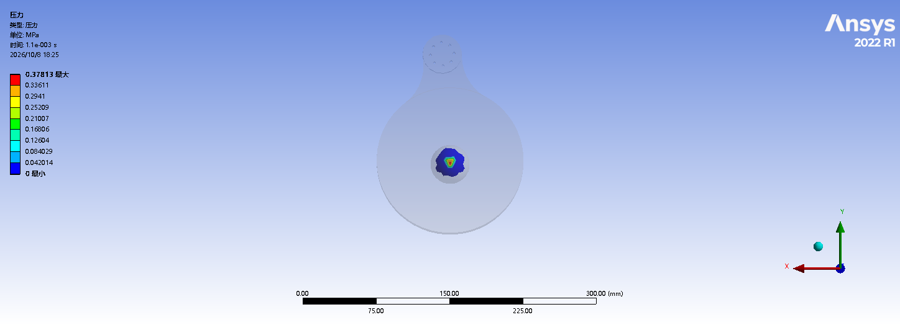
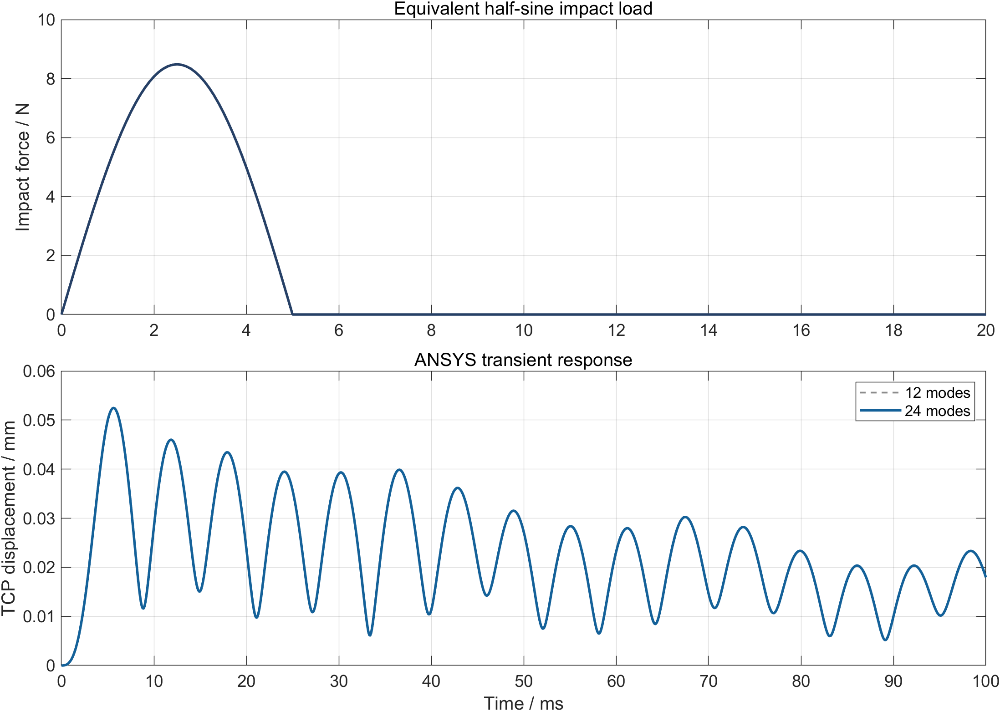

# 履带式击球机器人的有限元分析

`ANSYS Workbench` `Mechanical APDL` `模态分析` `接触瞬态` `SolidWorks Simulation`

## 项目简介

在已有履带底盘和六轴机械臂模型基础上增加末端球拍，围绕臂杆承载、结构振型与球拍接触开展分析。本页根据结项报告第三章整理，保留各算例的工况和结果对应关系。

图 1｜机器人整体结构及末端球拍。

## ANSYS Workbench 模态分析

模型保留基座、肩部壳体、大臂、肘部过渡件、小臂、腕部、输出法兰和球拍等 10 个主体。采用 6061-T6 铝合金材料，弹性模量 69 GPa，泊松比 0.33，密度 2700 kg/m³；基座固定，关节保持当前姿态。网格为 132771 个节点、614398 个单元。

图 2｜前六阶振型，按 2 列 × 3 行排列。模态变形为振型显示幅值，不代表实际工作位移。

| 阶次 | 固有频率 / Hz |
| --- | ---: |
| 1 | 18.985 |
| 2 | 42.582 |
| 3 | 55.522 |
| 4 | 98.342 |
| 5 | 127.252 |
| 6 | 140.069 |

[下载模态频率 CSV](downloads/modal_frequencies.csv)

## 球与球拍接触瞬态

球直径 40 mm、质量 2.7 g，以 2 m/s 沿拍面法向接近球拍，初始间隙约 1 mm。球拍安装面固定；球采用弹性模量 5 MPa、泊松比 0.35 的等效均质弹性模型。设置无摩擦接触及大变形，计算时长 8 ms，最大时间步长 0.05 ms，模型共 1882 个节点、7514 个单元。

| 接近拍面：0.1 ms | 接触过程：1.0 ms | 反弹分离：4.0 ms |
| :---: | :---: | :---: |
|  |  |  |

图 3｜同一接触算例的不同时刻。

图 4｜1.1 ms 接触压力云图，峰值约 0.378 MPa。球平均 Z 向速度由接近阶段的 −1983.2 mm/s 变为 4 ms 时的 1972.3 mm/s，反映该等效模型中的反弹过程。

## 锁定关节承力链的脉冲响应

另一个算例采用 Mechanical APDL 分析机械臂承力链在锁定关节条件下的附加弹性响应。该算例不是上述实体球接触模型：击球作用以 5 ms 半正弦脉冲输入，目标冲量为 0.027 N·s，对应 2.7 g 球的速度变化量 10 m/s。

图 5｜等效接触载荷及 TCP 附加位移，对比 12 阶和 24 阶模态叠加结果。

报告记录 TCP 附加位移峰值为 0.05246 mm，发生于 5.6 ms；实体节点附加位移最大值为 0.09570 mm，节点平均等效应力最大值为 5.456 MPa。增加模态阶数后，TCP 位移峰值变化约 0.0015%。这些数值属于该脉冲工况，不与关节运动位移或单零件静力位移相加。

## 静力学补充

SolidWorks Simulation 用于球拍、大臂和小臂的单零件静力分析，载荷包括自重及末端 10 N 等效静载。报告峰值应力分别为 11.363、6.249、7.019 MPa。球拍颈部峰值对局部网格仍有敏感性，成果主要用于分析应力集中位置和变形趋势。

[← 返回作品集](../../README.md)
