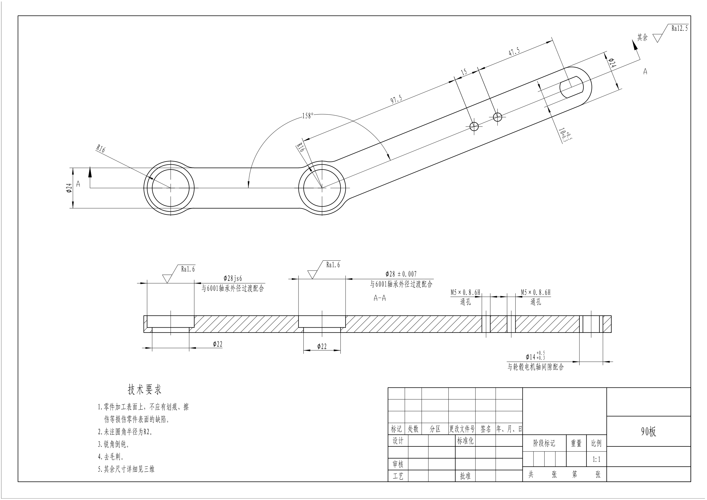
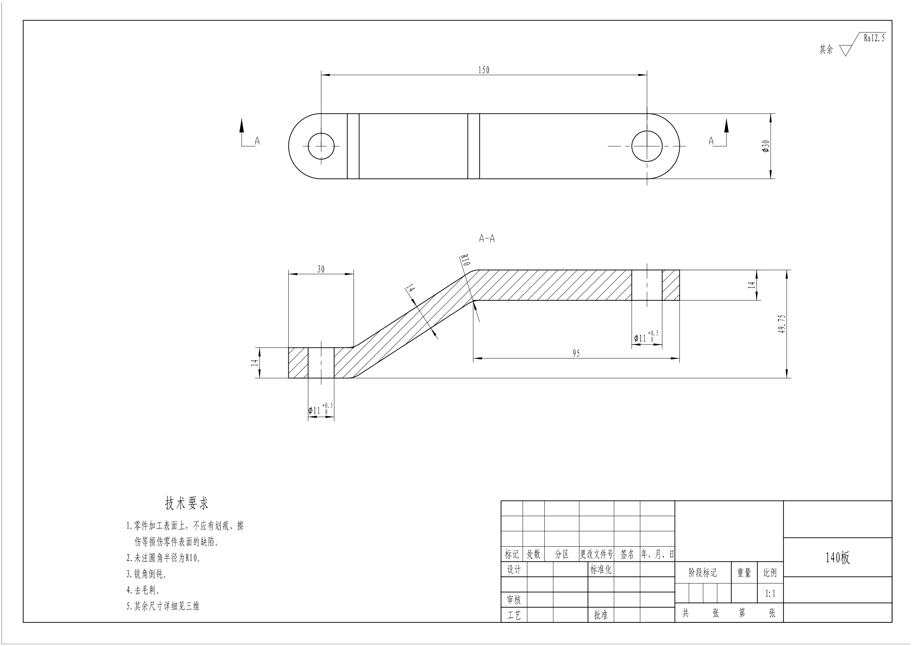

# 轮腿机器人底盘工程图

`SolidWorks` `CAD / CAXA` `装配图` `零件图`

本项目围绕轮腿机器人底盘完成三维结构整理、装配图及零件工程图。公开资料以最终修改的 DWG 为准，包含总装配图、左右板件、连接板和 CNC 侧板等。

图 1｜总装配图预览。[查看原生导出 PDF](pdf/assembly.pdf)

图 2｜90 板零件图预览。[查看原生导出 PDF](pdf/link-90.pdf)

图 3｜140 板零件图预览。[查看原生导出 PDF](pdf/link-140.pdf)

## 图纸下载

[下载最终 DWG 图纸包（13 张）](downloads/wheel_leg_final_DWG.zip)

包含 60 板、60 板-副、90 板及左右变型、140 板及左右变型、CNC 侧板、钣金件和总装配图。展示图片由 AutoCAD 原生打印 PDF 后转为 PNG，不使用 DXF 重绘预览；DWG 保留原有文字、尺寸和图层。

[← 返回作品集](../../README.md)
